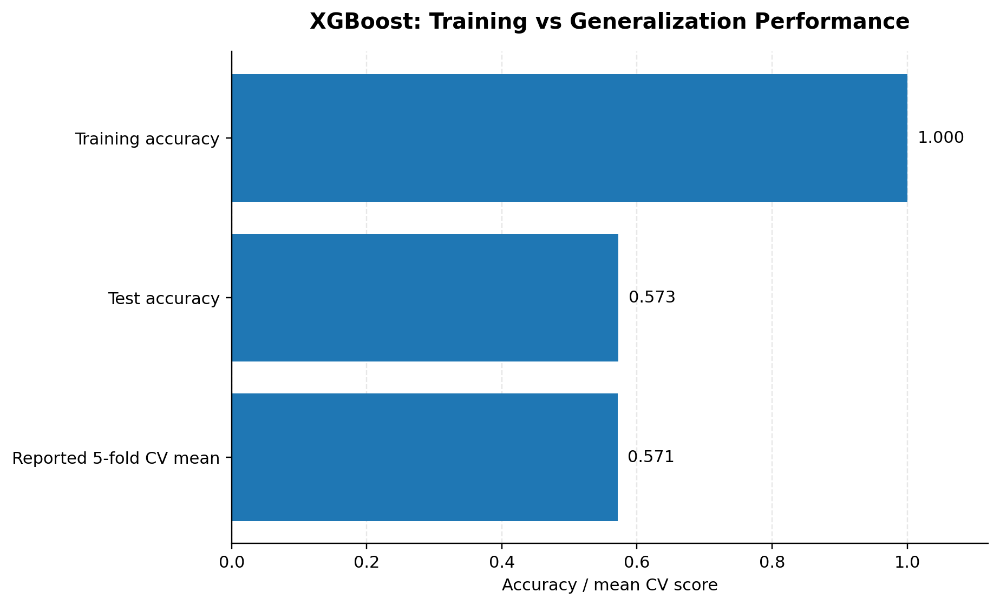
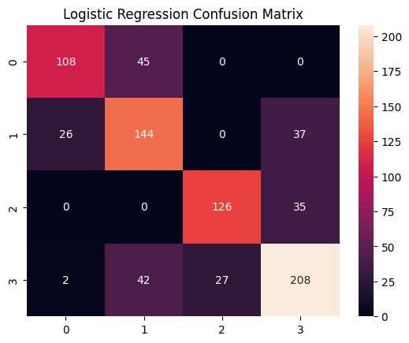
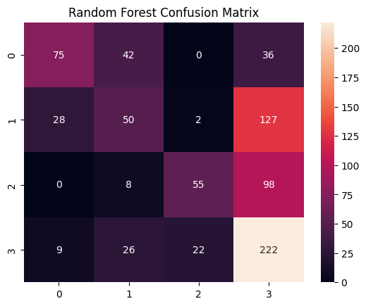
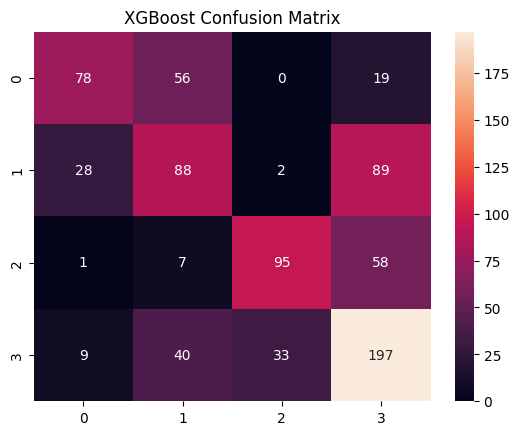
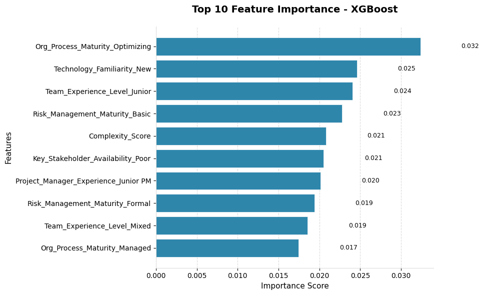
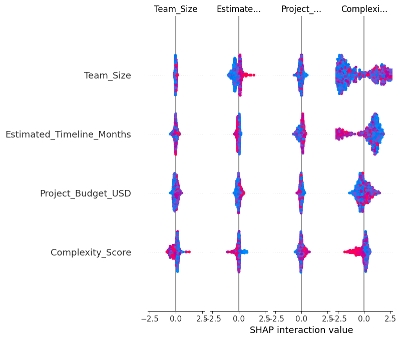
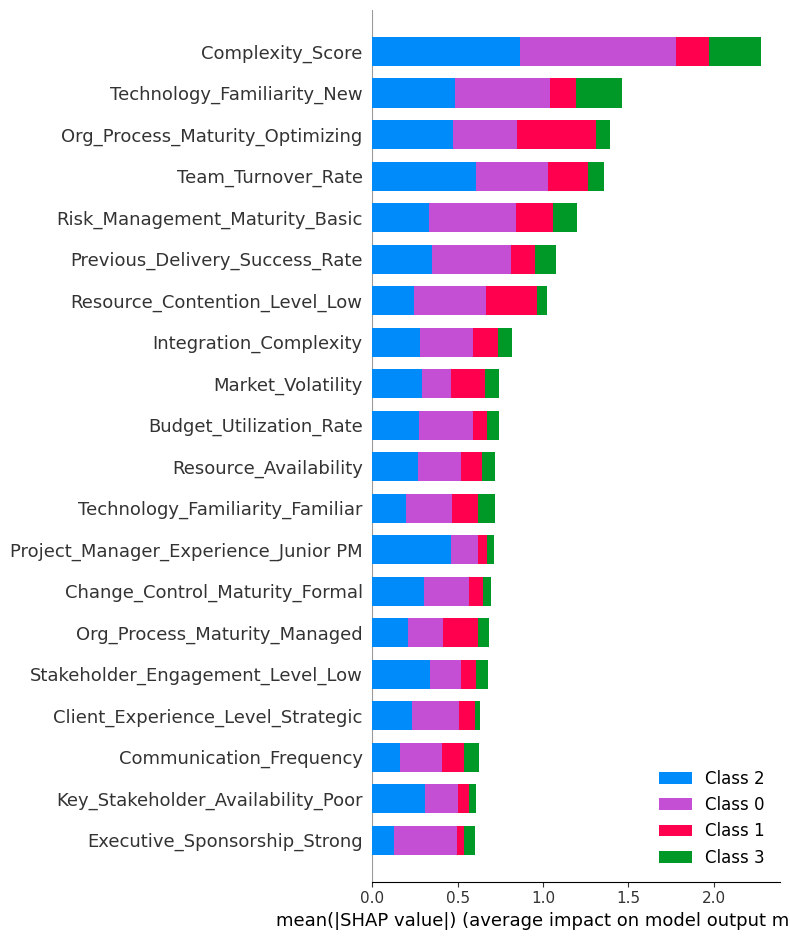

# Project Risk Prediction & Analytics

### An End-to-End Data Science, Machine Learning & Project Management Analytics Project

**Author:** Nematullah Amiri | PMP® | MBA  
**Project Domain:** Project Management | Risk Analytics | Predictive Modeling | Portfolio Oversight  
**Primary Tools:** Python, Pandas, NumPy, Scikit-learn, XGBoost, SHAP, Matplotlib, Seaborn

---

## 1. Project Overview

Project risk is a critical factor affecting project performance, delivery timelines, resource utilization, budgets, and the achievement of strategic objectives.

Projects operate in complex environments where factors such as project complexity, team experience, stakeholder availability, organizational process maturity, technology familiarity, and risk-management practices can influence the level of uncertainty and exposure.

This project applies an end-to-end data science methodology to explore project risk patterns, classify recorded project risk levels, and examine how machine learning can support project monitoring and management decision-making.

Using a dataset of 4,000 project records and 51 original variables, the analysis combines data exploration, statistical and visual analysis, predictive modeling, model evaluation, and explainable machine learning.

Three classification algorithms—Logistic Regression, Random Forest, and XGBoost—are developed and compared to evaluate their ability to classify project risk levels.

The project also incorporates feature-importance analysis and SHAP-based explainability to investigate how different project characteristics contribute to model predictions.

The broader objective is to demonstrate how data science and predictive analytics can complement traditional project risk management, programme monitoring, and portfolio oversight practices.

## 2. Business Problem

Project managers and portfolio oversight teams regularly deal with uncertainty arising from operational, organizational, technical, and stakeholder-related factors.

Traditional project risk management approaches often depend on periodic assessments, manually maintained risk registers, expert judgement, and retrospective reporting. Although these approaches remain important, they may not always reveal patterns across large project portfolios or provide consistent analytical support for identifying projects requiring additional attention.

The central business problem addressed in this project is:

**How can project-related data and machine learning techniques be used to identify patterns associated with project risk levels and support more informed project monitoring and management decisions?**

### Business Goal

The primary goal is to explore a predictive analytics framework that can classify project risk levels using available project characteristics and demonstrate how analytical findings could support risk identification, project monitoring, and portfolio-level decision-making.

### Project Objectives

- Examine the structure, quality, and characteristics of project-related data.
- Identify patterns across organizational, technical, managerial, and operational project variables.
- Explore the relationship between project characteristics and recorded risk levels.
- Prepare numerical and categorical variables for machine learning.
- Develop and compare multiple classification algorithms.
- Evaluate model performance using appropriate classification metrics.
- Identify influential predictors through feature-importance analysis.
- Apply SHAP explainability techniques to investigate model predictions.
- Explore potential applications of predictive analytics in project risk monitoring and portfolio oversight.
- Identify technical improvements required before operational implementation.

## 3. Dataset Description

The analysis uses a project-risk dataset containing 4,000 observations and 51 original columns.

The target variable is `Risk_Level`, which represents the recorded project risk category.

The notebook removes `Project_ID` from the predictor variables because it is an identifier rather than a substantive project characteristic.

| Dataset characteristic | Description |
|---|---|
| Total observations | 4,000 |
| Original variables | 51 |
| Identifier variable | `Project_ID` |
| Target variable | `Risk_Level` |
| Target classes | 4 encoded classes |
| Prediction type | Multiclass classification |
| Data format | CSV |
| Dataset filename | `Project_risk_raw_dataset.csv` |

### Key Project Characteristics

The notebook examines project-related variables covering several dimensions of project management.

| Variable / Dimension | Description |
|---|---|
| `Complexity_Score` | Project complexity indicator |
| `Org_Process_Maturity` | Organizational process maturity |
| `Technology_Familiarity` | Familiarity with project technology |
| `Team_Experience_Level` | Experience level of the project team |
| `Project_Manager_Experience` | Project manager experience category |
| `Risk_Management_Maturity` | Maturity of risk-management practices |
| `Key_Stakeholder_Availability` | Availability of key stakeholders |
| `Risk_Level` | Recorded project risk category (target) |

The dataset also includes additional project-related variables used in the notebook's predictive analysis.

**Dataset availability:** The notebook expects a CSV file named `Project_risk_raw_dataset.csv`. The dataset was not supplied with the notebook during repository preparation. Its original publisher, source URL, data dictionary, redistribution licence, and original risk-category labels therefore require confirmation before public release.

The target variable is encoded into four numerical classes (0, 1, 2, and 3) using `LabelEncoder`. The original category-to-number mapping should be documented in the final version of the project.

## 4. Analytical Methodology

The project follows a structured data science workflow inspired by the IBM Data Science Methodology.

The analysis is organized into four broad analytical areas: data understanding and preparation, predictive analytics, model interpretation, and management decision support.

### 4.1 Data Understanding and Exploratory Analysis – What Does the Dataset Contain?

The first stage examines the structure, characteristics, and quality of the project-risk dataset.

Key analytical activities include:

- Dataset dimensions and variable inspection.
- Data type identification.
- Missing-value assessment.
- Missing-value visualization.
- Numerical and categorical variable identification.
- Removal of non-predictive project identifiers.
- Examination of project-related characteristics.

Missing values are handled using the following methods in the current notebook:

- Categorical variables: Mode imputation.
- Numerical variables: Median imputation.

These activities establish the initial data preparation process for subsequent modeling.

### 4.2 Data Preparation – How Is the Data Prepared for Modeling?

The second stage prepares the dataset for machine learning.

The notebook implements the following procedures:

1. Remove the `Project_ID` identifier.
2. Identify numerical and categorical variables.
3. Impute missing categorical values using the mode.
4. Impute missing numerical values using the median.
5. Encode the target variable `Risk_Level` using LabelEncoder.
6. Apply one-hot encoding to categorical predictor variables.
7. Divide the dataset into training and testing subsets.
8. Apply feature standardization for Logistic Regression.

An 80:20 stratified train-test split is used with `random_state=42`.

**Important methodological consideration:** In the current notebook, missing-value imputation and categorical encoding are performed before the train-test split. This introduces a risk of data leakage. For a more reliable evaluation, these preprocessing steps should be fitted only on training data through a Scikit-learn Pipeline and ColumnTransformer.

### 4.3 Predictive Analytics – How Accurately Can Project Risk Be Classified?

The third stage develops and evaluates three machine learning classification algorithms.

**Selected algorithms:**

- Logistic Regression
- Random Forest Classifier
- XGBoost Classifier

#### Model Development Process

1. Separate predictor variables from the target variable.
2. Prepare numerical and categorical features.
3. Apply the training and testing split.
4. Standardize features for Logistic Regression.
5. Train the Logistic Regression classifier.
6. Train the Random Forest classifier.
7. Train the XGBoost classifier.
8. Generate predictions on the test dataset.
9. Evaluate model performance using classification metrics.
10. Compare confusion matrices and classification reports.
11. Calculate five-fold cross-validation performance for XGBoost.

#### Model Performance

The following results are taken from the executed notebook outputs.

| Evaluation metric | Logistic Regression | Random Forest | XGBoost |
|---|---:|---:|---:|
| Accuracy | **73.25%** | 50.25% | 57.25% |
| Macro Precision | **0.75** | 0.56 | 0.60 |
| Macro Recall | **0.73** | 0.47 | 0.56 |
| Macro F1-score | **0.74** | 0.48 | 0.57 |
| Weighted F1-score | **0.73** | 0.48 | 0.57 |

#### Model Performance Comparison


**Performance interpretation**

- **Logistic Regression:** Achieves the strongest overall performance, with 73.25% test accuracy and a macro F1-score of 0.74.
- **Random Forest:** Achieves 50.25% test accuracy and a macro F1-score of 0.48.
- **XGBoost:** Achieves 57.25% test accuracy and a macro F1-score of 0.57.

Based on the current test-set results, Logistic Regression performs better than the two tree-based models.

This demonstrates that a comparatively simpler classification algorithm can outperform more complex models on a particular dataset.

However, these results are preliminary because the current preprocessing workflow introduces potential data leakage. The models should be re-evaluated using a leakage-free pipeline before making a final model-selection decision.

#### XGBoost Generalization Performance

The notebook records the following XGBoost performance:

| Evaluation measure | Result |
|---|---:|
| Training accuracy | 100.00% |
| Test accuracy | 57.25% |
| Mean five-fold cross-validation score | 57.125% |



The difference between training and test accuracy indicates substantial overfitting. The model fits the training observations extremely well but does not achieve comparable performance on unseen test observations.

The reported cross-validation result also requires further validation because preprocessing was conducted before the cross-validation procedure.

### 4.4 Model Evaluation – How Well Does Each Model Classify Risk Levels?

Confusion matrices are used to examine classification performance across the four encoded target classes.

They provide additional information about correct predictions and classification errors that cannot be fully understood through accuracy alone.

#### Logistic Regression



#### Random Forest



#### XGBoost



The confusion matrices help identify which encoded risk categories are more difficult for the models to distinguish.

The original category names corresponding to encoded classes 0–3 should be confirmed before assigning business interpretations to individual classes.

### 4.5 Explainable Machine Learning – Which Features Influence Model Predictions?

The project incorporates feature-importance analysis and SHAP (SHapley Additive exPlanations) to investigate the contribution of project characteristics to the predictions generated by XGBoost.

The purpose of this analysis is to improve model interpretability and examine which variables receive greater importance within the fitted model.

#### Top 10 XGBoost Features

The notebook reports the following ten features as the highest-ranked variables by XGBoost feature importance.

| Rank | Feature | Importance |
|---:|---|---:|
| 1 | `Org_Process_Maturity_Optimizing` | 0.032351 |
| 2 | `Technology_Familiarity_New` | 0.024585 |
| 3 | `Team_Experience_Level_Junior` | 0.024073 |
| 4 | `Risk_Management_Maturity_Basic` | 0.022783 |
| 5 | `Complexity_Score` | 0.020826 |
| 6 | `Key_Stakeholder_Availability_Poor` | 0.020522 |
| 7 | `Project_Manager_Experience_Junior PM` | 0.020148 |
| 8 | `Risk_Management_Maturity_Formal` | 0.019384 |
| 9 | `Team_Experience_Level_Mixed` | 0.018568 |
| 10 | `Org_Process_Maturity_Managed` | 0.017452 |

#### Feature Importance Visualization



#### SHAP Summary Analysis

The notebook also uses SHAP to examine the contribution of individual features to model predictions.

**SHAP Beeswarm Plot**



**SHAP Global Feature Importance**



These visualizations provide an additional perspective on the behavior of the fitted XGBoost model.

**Interpretation caution:** Feature importance and SHAP values describe how the current model uses its input variables. They do not establish causal relationships between project characteristics and risk outcomes. Because the current XGBoost model shows substantial overfitting, these explanations should be regenerated after correcting the preprocessing workflow and validating the model.

## 5. Key Analytical Insights

The current analysis highlights several project characteristics that deserve further investigation in project risk management and portfolio oversight.

**1. Organizational process maturity**

Organizational process maturity appears among the highest-ranked features in the current XGBoost feature-importance analysis. This highlights the relevance of examining organizational processes when studying project risk classification.

**2. Technology familiarity**

Technology familiarity is another prominent feature in the model's importance ranking. This suggests that technology-related characteristics are worth examining in greater detail when assessing project environments.

**3. Team experience**

Team experience level and project manager experience both appear among the top-ranked XGBoost features. These variables provide a basis for further investigation into the relationship between project delivery capabilities and recorded risk categories.

**4. Risk-management maturity**

Risk-management maturity is represented by multiple categorical features among the top ten XGBoost predictors. This makes it an important dimension for further analytical examination.

**5. Project complexity**

`Complexity_Score` appears among the ten highest-ranked features. Project complexity is therefore a relevant variable to investigate in subsequent model development and project risk analysis.

**6. Stakeholder availability**

The feature `Key_Stakeholder_Availability_Poor` also appears in the top ten. Stakeholder availability is a potentially important dimension for further examination in project monitoring and risk assessment.

These observations are based on the current fitted XGBoost model and should be treated as exploratory findings rather than confirmed causal or independently validated relationships.

## 6. Potential Business Applications

The project demonstrates how predictive analytics could complement established project management and portfolio oversight practices.

If future validation establishes acceptable predictive performance, similar analytical approaches could be explored in the following areas:

| Application area | Potential management value |
|---|---|
| Project risk screening | Identify projects requiring additional assessment |
| Portfolio oversight | Support comparative analysis across projects |
| Project monitoring | Highlight project characteristics associated with elevated risk |
| Management reporting | Provide analytical evidence for project review meetings |
| Resource planning | Support discussions about team experience and capacity |
| Risk management | Complement existing risk registers and assessment processes |
| Strategic decision support | Provide additional information for portfolio-level discussions |

The model should be considered an analytical support tool rather than a replacement for professional judgement, established project controls, or formal risk-management procedures.

## 7. Technology Stack

| Technology | Application |
|---|---|
| Python | Core programming language |
| Pandas | Data manipulation and analysis |
| NumPy | Numerical computation |
| Matplotlib | Data visualization |
| Seaborn | Statistical visualization |
| Scikit-learn | Data preprocessing, classification, and model evaluation |
| XGBoost | Gradient boosting classification |
| SHAP | Model explainability |
| Missingno | Missing-value visualization |
| Joblib | Model serialization |
| Jupyter Notebook / Google Colab | Interactive analytical environment |

## 8. Project Workflow

The overall analytical workflow can be summarized as follows:

```text
Business Understanding
        |
        v
Data Collection & Loading
        |
        v
Data Understanding
        |
        v
Exploratory Data Analysis
        |
        v
Data Preparation
        |
        v
Feature Encoding & Transformation
        |
        v
Train-Test Split
        |
        v
Machine Learning Model Development
        |
        +-------------------------------+
        |               |               |
        v               v               v
   Logistic         Random          XGBoost
  Regression        Forest           Model
        |               |               |
        +---------------+---------------+
                        |
                        v
                 Model Evaluation
                        |
                        v
               Model Comparison
                        |
                        v
              Feature Importance
                        |
                        v
                SHAP Analysis
                        |
                        v
              Management Insights
                        |
                        v
              Project Risk Decision
                   Support
```

## 9. Repository Structure

The project repository contains the analytical notebook, supporting dependencies, documentation, and generated visualizations.

```text
project-risk-prediction/
│
├── README.md
├── requirements.txt
├── .gitignore
├── Projects_Risk_Prediction.ipynb
│
└── reports/
    │
    ├── FIGURES_GUIDE.md
    │
    └── figures/
        ├── model_performance_comparison.png
        ├── xgboost_generalization_gap.png
        ├── confusion_matrix_logistic_regression.png
        ├── confusion_matrix_random_forest.png
        ├── confusion_matrix_xgboost.png
        ├── xgboost_feature_importance_all.png
        ├── xgboost_feature_importance_top10.png
        ├── shap_summary_beeswarm.png
        └── shap_summary_bar.png
```

**Dataset:** The notebook expects `Project_risk_raw_dataset.csv`, which is not included in the repository package. Add it only if its source and redistribution permissions allow public sharing. Otherwise, document how authorized users can obtain it.

## 10. Installation and Execution

### Prerequisites

- Python 3.9 or later.
- Jupyter Notebook or Google Colab.
- Required Python libraries.
- Authorized access to `Project_risk_raw_dataset.csv`.

### Clone the repository

```bash
git clone https://github.com/NematullahAmiri/project-risk-prediction.git

cd project-risk-prediction
```

### Create a virtual environment (Windows)

```bash
python -m venv .venv

.venv\Scripts\activate
```

### Install dependencies

```bash
python -m pip install --upgrade pip

pip install -r requirements.txt
```

### Add the dataset

Place the authorized dataset file in the repository root using the exact filename:

```text
Project_risk_raw_dataset.csv
```

The notebook currently contains a Google Colab file-upload procedure. If running locally, replace the upload section with:

```python
import pandas as pd

df = pd.read_csv("Project_risk_raw_dataset.csv")
```

### Run the notebook

```bash
jupyter notebook
```

Open `Projects_Risk_Prediction.ipynb` and execute the cells sequentially.

**Note:** The saved model in the current notebook is `project_risk_model.pkl`. It represents the fitted XGBoost estimator, not a complete reusable preprocessing-and-prediction pipeline.

## 11. Limitations and Future Improvements

Although the project demonstrates a structured machine learning approach to project risk classification, several improvements are necessary before the results can support operational decisions.

### Model Development and Performance

- Improve the generalization performance of the tree-based models.
- Investigate XGBoost overfitting through hyperparameter tuning and regularization.
- Compare alternative classification algorithms.
- Evaluate class-specific precision, recall, and F1-scores.
- Consider class imbalance and its effect on model performance.
- Use consistent preprocessing and validation procedures across all models.

### Data Preparation and Model Validation

- Implement preprocessing through Scikit-learn Pipelines and ColumnTransformers.
- Fit imputers and encoders only on training data.
- Perform cross-validation within the complete preprocessing pipeline.
- Confirm the original `Risk_Level` category names and encoded-label mapping.
- Review feature availability at the intended prediction time.
- Document the dataset source, data dictionary, and licence.

### Model Explainability

- Regenerate feature-importance rankings after model revalidation.
- Recalculate SHAP values using the final validated model.
- Examine class-specific explanations.
- Investigate whether the most influential features are consistent across validation samples.

### Deployment and Practical Application

- Save the complete preprocessing and prediction pipeline.
- Store the target-label mapping alongside the model.
- Develop a reproducible prediction interface.
- Consider an interactive project risk analytics dashboard.
- Establish model monitoring and periodic performance evaluation.
- Validate the model using independent project data before operational use.

## 12. Conclusion

This project demonstrates how data science and machine learning can be applied to project risk classification and management analytics.

By combining exploratory data analysis, data preparation, classification algorithms, model evaluation, feature importance, and SHAP explainability, the project provides an analytical framework for examining patterns in project-related risk data.

The current model comparison shows that Logistic Regression achieves the strongest recorded test performance, with 73.25% accuracy and a macro F1-score of 0.74. Random Forest and XGBoost achieve lower test-set performance, while XGBoost exhibits a substantial training-to-test performance gap.

Beyond the technical exercise, the project illustrates how predictive analytics could complement project risk management, programme monitoring, and portfolio oversight by providing additional evidence for identifying project characteristics that deserve management attention.

The next stage is to improve the data preparation and validation process, strengthen model generalization, and test the final model on independent project data.

The long-term objective is to develop a reliable and explainable project risk analytics solution that can support evidence-based project management and portfolio-level decision-making.

---

## 13. Author

**Nematullah Amiri | PMP® | MBA**

Data Science | Business Intelligence | Project Analytics | Development Research | Project Management

- **GitHub:** [https://github.com/NematullahAmiri](https://github.com/NematullahAmiri)
- **Portfolio:** [https://nematullahamiri.github.io/](https://nematullahamiri.github.io/)
- **LinkedIn:** Add your LinkedIn profile URL here.

*This project is developed for data science, machine learning, project management analytics, and management decision-support portfolio purposes. The reported model results are preliminary and should not be interpreted as operationally validated project risk predictions.*
